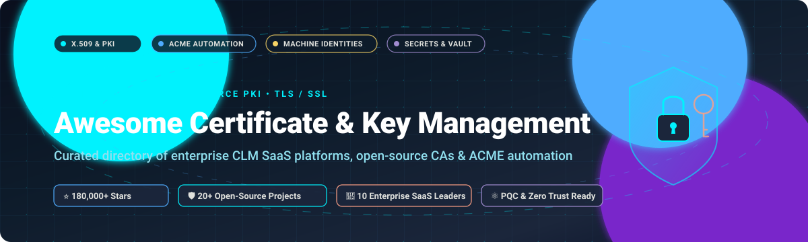

# Awesome-Certificate-Key-Management

# Awesome-Certificate-Key-Management 🔐 🗝️

  

  

  

  

  

  

  

---

## 🌟 Top Certificate & Key Management Ecosystem

**Curated List of Commercial CLM/PKI Platforms & Open-Source Certificate Authority Tools**  

*Focused on Certificate Lifecycle Management, PKI, ACME Automation, Secrets Management, Key Rotation & Self-Hosted Certificate Authorities*

**Last updated: October 2026** 📅

---

### 📌 Overview & SEO Summary

Welcome to the ultimate curated directory of **certificate and key management platforms**, **open-source PKI frameworks**, and **ACME automation tools**. Whether you are looking for enterprise-grade commercial solutions (such as *Venafi*, *Keyfactor*, and *DigiCert*), or self-hostable open-source alternatives (like *EJBCA*, *OpenXPKI*, and *Certimate*), this list covers category leaders, certificate lifecycle automation, and privacy-respecting PKI infrastructure.

**Key Market Context:**

- **HashiCorp Vault’s PKI engine, cert-manager for Kubernetes, and Keyfactor’s open-source EJBCA are the common free routes for CLM** — they remove licensing cost but carry operational overhead and generally do less on enterprise-wide discovery and governance than commercial platforms .

- **OpenBao** is currently one of the most widely discussed open-source alternatives to HashiCorp Vault, created as a community-led fork designed for enterprise secrets management while preserving an OSI-approved open source approach .

- **EJBCA** is the leading open-source PKI and certificate authority software, with **953 GitHub stars**, supporting certificate enrollment, key archival, OCSP, and smartcard management .

- **OpenXPKI** is the leading open-source enterprise-scale PKI software, with **694 GitHub stars**, providing certificate lifecycle management for enterprise-grade deployments .

- **Dogtag Certificate System** is an enterprise-class Certificate Authority supporting all aspects of certificate lifecycle management, including key archival, OCSP, and smartcard management, with **509 GitHub stars** .

- **CFSSL** is Cloudflare's PKI and TLS toolkit, with **9,475 GitHub stars**, providing certificate authority and signing capabilities .

- **Lemur** by Netflix is an open-source certificate manager, with **1,771 GitHub stars**, for certificate lifecycle management .

- **Certimate** is the leading open-source self-hosted SSL certificate ACME tool, automating the full-cycle of issuance, deployment, renewal, and monitoring with support for **70+ domain registrars** and **160+ deployment destinations** .

- **Smallstep CA** is a private certificate authority with **8,892 GitHub stars**, providing X.509 and SSH certificate management with ACME server support .

- **ILM (Identity Lifecycle Management)** is an open-source platform providing certificate management, cryptographic key management, secrets management through Vault Profile, and CBOM scanning .

---

## 📑 Table of Contents

- [🏢 SaaS & Commercial Platforms](#-saas--commercial-platforms)

- [🔓 Open-Source GitHub Projects](#-open-source-github-projects)

- [🛠️ How to Contribute](#%EF%B8%8F-how-to-contribute)

- [📊 Star History](#-star-history)

- [🤝 Support & Sponsorship](#-support--sponsorship)

- [⚠️ Disclaimer](#%EF%B8%8F-disclaimer)

---

## 🏢 SaaS / Commercial Platforms

> **Market Size & Structure:** The global Certificate Lifecycle Management (CLM) and Machine Identity Management (MIM) market is valued at approximately **$3.2 Billion in 2025** (projected to reach **$7.4B – $9.8B by 2034** at ~13% CAGR). The sector is **moderately fragmented**—driven by diverse multi-cloud requirements and specialized niche protocols without a single winner-take-all monopoly, though undergoing active consolidation via major acquisitions (e.g., Palo Alto Networks acquiring CyberArk, CyberArk acquiring Venafi, IBM acquiring HashiCorp).

| SaaS / Commercial Platform | Company / Owner | Valuation / Market Cap (Descending) | Pricing (Starting Tier) | Free Tier / Free Trial Limits | Description |
| :--- | :--- | :--- | :--- | :--- | :--- |
| **[Azure Key Vault](https://azure.microsoft.com/en-us/products/key-vault/)** 🔷 | Microsoft | ~$3.90 Trillion | **$0.03 per 10,000 operations** (Software keys/secrets); $3.00/cert renewal | **12-month free tier: 10,000 operations/month** + $200 initial 30-day credits | **Azure-native certificate and key management** — Keys, secrets, and certificates in one service. Managed HSM tier for FIPS 140-2 Level 3. Soft-delete and purge protection. |
| **[AWS Certificate Manager](https://aws.amazon.com/certificate-manager/)** ☁️ | Amazon | ~$2.00 Trillion | **$0.00** (Free for AWS-integrated services); $400/month (AWS Private CA) | **Free forever for all public SSL/TLS certs** used on CloudFront, ALB, API Gateway; 30-day trial for Private CA ($400 CA fee waived; per-cert fees apply) | **AWS-native certificate management** — Free public certificates for AWS services. Private CA available for enterprise PKI. Automatic renewal and deployment to ELB, CloudFront, and API Gateway. |
| **[Salesforce Certificate Management](https://help.salesforce.com/)** ☁️ | Salesforce | ~$250 Billion | **$25/user/month** (Salesforce Starter Suite edition includes Certificate & Key Management) | **Free forever Developer Edition org** (includes full Certificate & Key Management features; limited to 2 user licenses, 5 MB data storage, 20 MB file storage) | **Salesforce-native certificate management** — X.509 certificate management for connected apps, SAML, and mutual TLS integrations. Automated certificate expiry alerts and rotation. |
| **[CyberArk](https://www.cyberark.com/)** 🏛️ | Palo Alto Networks | ~$25 Billion (Acquisition) | **$2,400/user/year** (Privilege Cloud); Conjur Cloud starting from ~$40/workload identity | **Free forever: Conjur Open Source (OSS)**; 30-day free trial available for Secure Cloud Access via AWS Marketplace | **Privileged access and secrets management** — Conjur for machine identities and DevOps workflows. Secrets Provider for Kubernetes and External Secrets Operator. Enterprise Password Vault for human privileged accounts. |
| **[DigiCert Trust Lifecycle Manager](https://www.digicert.com/)** 🟢 | DigiCert (Clearlake / TA Associates) | ~$8.0 Billion | **$399/year** (DigiCert ONE starter / single business TLS seat tier) | **30-day free trial account** (available via DigiCert Sales/Demo Center for Trust Lifecycle Manager); includes free ACME automation for subscribed domains | **Certificate lifecycle management** — Comprehensive event logs for enrollments, certificate lifecycle activities, seats, and connectors. Manual approval workflows for enrollment requests. |
| **[Venafi](https://www.venafi.com/)** 🦅 | Palo Alto Networks / CyberArk | ~$8.0 Billion (Acquisition value) | **$8.00 – $18.00/certificate/year** (~$150,000/year enterprise base deployment) | **30-day free trial** for TLS Protect Cloud SaaS (unlimited discovery scan across domains); Free forever open-source SDKs (`vcert`) and cert-manager integrations | **Machine identity management leader** — Discovery, governance, and automation of certificates and keys across hybrid environments. Open-source SDKs: vcert (Go), vcert-python, vcert-java. Vault PKI Secrets Engine plugin. |
| **[HashiCorp Vault](https://www.vaultproject.io/)** 🔐 | IBM / HashiCorp | ~$5.0 Billion (Acquisition) | **$0.62/hour** ($450/month, HCP Vault Dedicated Development cluster) | **Free forever: Community Edition (self-hosted)**; HCP Vault Cloud includes **$500 free credit** for new accounts | **Identity-based secrets management with PKI** — Dynamic secrets, PKI engine, and encryption as a service. Short-lived certificates for workloads and service meshes. OpenBao fork available. |
| **[Keyfactor](https://www.keyfactor.com/)** 🔑 | Keyfactor (Summit Partners) | ~$1.3 Billion ($200M+ ARR) | **~$75,000/year** (Enterprise Command platform tier, scales by managed certificate volume) | **30-day free Test Drive** (cloud-hosted pre-configured Keyfactor Command SaaS environment, auto-decommissioned after 30 days); Free forever: EJBCA Community Edition | **PKI and CLM platform** — Command SaaS with third-party CA integration. EJBCA open-source PKI with 950+ GitHub stars. Workflows with approval steps and immutable audit logs. |
| **[Sectigo Certificate Manager](https://sectigo.com/)** 🔵 | Sectigo (GI Partners) | ~$900 Million | **$96.00/domain/year** (SCM Pro starting tier for automated DV certificate management) | **30-day free trial** for Sectigo Certificate Manager (SCM Pro) with full ACME discovery and automation features | **Certificate management platform** — Automated issuance, renewal, and deployment. ACM, Azure Key Vault, and F5 BIG-IP integrations. |
| **[AppViewX](https://www.appviewx.com/)** 🎯 | AppViewX (Haveli Investments) | ~$100 Million ($50M+ funding) | **$4,200/year** (AVX ONE CLM starter tier for up to 250 server certificates via AWS Marketplace) | **30-day free trial** (extendable up to 90 days upon request via AWS Marketplace / AppViewX SaaS onboarding); includes free certificate discovery scan | **Certificate lifecycle automation** — Discovery, renewal, and deployment automation across multi-cloud and on-prem. AVX ONE platform for non-human identities. |

---

## 🔓 Open-Source GitHub Projects

*Sorted by GitHub_Stars_Count (Descending)* 🌟

- **[CFSSL](https://github.com/cloudflare/cfssl)**   

  **Cloudflare's PKI and TLS toolkit**, BSD-2-Clause licensed. **9,475 GitHub stars** — **the most widely deployed open-source PKI toolkit** . **Certificate authority and signing capabilities** . **Used for internal PKI, TLS certificate issuance, and certificate chain building** . **The definitive open-source PKI toolkit**  . 🔧

- **[Smallstep CA](https://github.com/smallstep/certificates)**   

  **Private certificate authority for X.509 & SSH with ACME server**, Apache-2.0 licensed. **8,892 GitHub stars** — **the leading modern open-source private CA** . **ACME server for automated certificate management** . **X.509 and SSH certificate issuance** . **Supports TLS everywhere with automated certificate lifecycle**  . 🔐

- **[Bouncy Castle Java](https://github.com/bcgit/bc-java)**   

  **Java cryptography and PKI library**, MIT licensed. **2,693 GitHub stars** — **the foundational Java cryptography library** . **X.509 certificate generation, parsing, and validation** . **CMS, PKCS, and OpenPGP support** . **Used by EJBCA, OpenXPKI, and most Java PKI implementations**  . ☕

- **[OpenSC](https://github.com/OpenSC/OpenSC)**   

  **Open-source smart card tools and middleware**, LGPL-2.1 licensed. **3,093 GitHub stars** — **PKCS#11 and MiniDriver support** . **Smart card and HSM integration** . **Used for certificate storage and cryptographic operations**  . 🪪

- **[XCA](https://github.com/chris2511/xca)**   

  **X Certificate and Key management**, BSD-3-Clause licensed. **2,014 GitHub stars** — **GUI for certificate and key management** . **X.509 certificate creation, signing, and revocation** . **PKCS#12, PKCS#8, and SSH key support** . **Best for individual certificate management**  . 🗝️

- **[Netflix Lemur](https://github.com/Netflix/lemur)**   

  **Certificate management and orchestration**, Apache-2.0 licensed. **1,771 GitHub stars** — **Netflix's open-source certificate manager** . **Certificate issuance, renewal, and deployment automation** . **CA integration and certificate discovery**  . 🎬

- **[SoftHSMv2](https://github.com/softhsm/SoftHSMv2)**   

  **Software implementation of a generic cryptographic device with a PKCS#11 interface**, BSD-2-Clause licensed. **1,096 GitHub stars** — **the reference open-source SoftHSM** . **Designed for testing and development** . **Supports PKCS#11 v2.40** . **The foundation for HSM testing**  . 🏛️

- **[FreeIPA](https://github.com/freeipa/freeipa)**   

  **Integrated identity and authentication solution for Linux/UNIX networks**, GPL-3.0 licensed. **1,281 GitHub stars** — **combines LDAP, Kerberos, DNS, NTP, and certificate services** . **Certificate authority integrated with identity management** . **The most complete open-source identity and PKI solution for Linux environments**  . 🐧

- **[EJBCA Community Edition](https://github.com/Keyfactor/ejbca-ce)**   

  **Open-source public key infrastructure (PKI) and certificate authority (CA) software**, LGPL-2.1 licensed. **953 GitHub stars** — **the leading open-source enterprise PKI** . **Certificate enrollment, key archival, OCSP responder, and smartcard management** . **Supports ACME, CMP, EST, SCEP protocols** . **The definitive open-source CA for enterprise deployments**  . 🏢

- **[OpenXPKI](https://github.com/openxpki/openxpki)**   

  **Open-source enterprise-scale PKI software**, Apache-2.0 licensed. **694 GitHub stars** — **comprehensive certificate lifecycle management** . **Workflow engine for customizable PKI processes** . **Hardware Security Module (HSM) support** . **Web, REST, SOAP, and SCEP interfaces** . **The most flexible open-source PKI workflow engine**  . 🔄

- **[XiPKI](https://github.com/xipki/xipki)**   

  **Compact open source PKI (CA, OCSP responder)**, Apache-2.0 licensed. **605 GitHub stars** — **full support of PQC ML-DSA (Dilithium)** . **Supports ACME, CMP, EST, SCEP protocols** . **The most modern open-source PKI with post-quantum cryptography support**  . ⚛️

- **[Dogtag Certificate System](https://github.com/dogtagpki/pki)**   

  **Enterprise-class Certificate Authority**, GPL-2.0 licensed. **509 GitHub stars** — **supports all aspects of certificate lifecycle management** . **Key archival, OCSP, and smartcard management** . **The upstream for Red Hat Certificate System** . **Java-based with comprehensive CLI and GUI**  . 🏛️

- **[ILM (Identity Lifecycle Management)](https://github.com/OmniTrustILM/ilm)**   

  **Open, transparent, flexible, modern platform for identity lifecycle management**, Apache-2.0 licensed. **Certificate management (issuing, revocation, renewal) through RA Profile and standard protocols** . **Cryptographic key management through Token Profile** . **Secrets management (passwords, API keys, JWT tokens, keystores) through Vault Profile with versioning, cross-vault synchronization, and approval workflows** . **Cryptographic Bill of Materials (CBOM) scanning and repository** . **Extensible connectors for CAs, credentials, discovery engines, and cryptography** . **The most complete open-source PKI and secrets lifecycle platform**  . 🏗️

- **[Certimate](https://github.com/certimate-go/certimate)**   

  **Open-source self-hosted SSL certificate ACME tool**, MIT licensed. **Automates the full-cycle of issuance, deployment, renewal, and monitoring visually** . **Supports 70+ domain registrars** (AWS, Cloudflare, GoDaddy, Alibaba Cloud, Tencent Cloud) . **160+ deployment destinations** (Kubernetes, CDN, WAF, load balancers) . **Multiple ACME CAs: Let's Encrypt, Actalis, Google Trust Services, SSL.com, ZeroSSL** . **Supports RSA/ECC keys, DNS-01 and HTTP-01 challenges, PEM/PFX/JKS formats** . **~20 MB memory footprint, zero dependencies** . **The most complete open-source ACME automation tool**  . 🚀

- **[OpenBao](https://github.com/openbao/openbao)**   

  **Open-source, community-driven fork of Vault managed by the Linux Foundation’s OpenSSF**, MPL-2.0 licensed. **95% vitality score on the EU OSS Catalogue** . **Secure secret storage with encryption at rest** . **Dynamic secrets for databases and Kubernetes**  . **PKI engine for certificate issuance** . **Tree-based revocation and leasing** . **The community-governed successor to HashiCorp Vault**  . 🏛️

- **[Infisical](https://github.com/Infisical/infisical)**   

  **Developer-friendly secrets management platform**, MIT licensed (core). **Self-hosted or Infisical Cloud** . **Secret synchronization across applications, teams, and environments** . **GitHub Actions, GitLab CI, Jenkins, AWS, GCP, Azure, and Kubernetes integrations**  . **SOC 2 Type II certified** . **The most developer-friendly open-source secrets platform**  . 🌿

- **[CyberArk Conjur Open Source](https://github.com/cyberark/conjur)**   

  **Secrets management for machine identities and DevOps workflows**, Apache-2.0 licensed. **Secures application credentials and machine identities**  . **Secrets Provider for Kubernetes** and **External Secrets Operator**  . **Best for organizations already invested in CyberArk PAM**  . 🔐

- **[ManUp](https://github.com/procoder588/manup)**   

  **Open-source, self-hosted Secrets Management platform**, open-source. **Centralized secrets vault with encrypted storage** . **Granular RBAC (Owner, Admin, Viewer)** . **Project-scoped and fine-grained API keys** . **Direct Query API and .env export** for CI/CD pipelines . **Lightweight, developer-friendly alternative to Infisical and HashiCorp Vault** . **Docker and Docker Compose deployment with embedded PostgreSQL (PGLITE)** . **Official CLI tool (manup-cli)** for seamless secret injection**  . 🔒

- **[Lowkey Vault](https://github.com/nagyesta/lowkey-vault)**   

  **Test double for Azure Key Vault**, MIT licensed. **Low footprint alternative for testing and CI** . **NOT for production** — **does not use security measures to keep secrets safe**  . **Supports keys (RSA, EC, OCT), secrets, and certificates** . **Docker and Testcontainers support** . **Best for local development and testing**  . 🧪

---

## 🛠️ How to Contribute

Contributions are welcome! Follow these steps to submit new certificate and key management platforms or open-source PKI software:

1. 🍴 **Fork** the repository.

2. 📝 **Add/edit** entries in `README.md` maintaining table/list structure and formatting.

3. 🔗 Include project title, official website/GitHub link, exact Stars_Count, license, and brief description.

4. 🚀 Submit a **Pull Request** with a descriptive summary of your changes.

---

## 📊 Star History

---

## 🤝 Support & Sponsorship

If you find this certificate and key management repository useful, please consider supporting the project:

- ⭐ **Star** this repository to increase visibility!

- 🔀 **Fork** and share with fellow security engineers, PKI architects, and open-source advocates.

- ☕ **Sponsor & Buy Me a Coffee**: Support ongoing open-source curation via the [GitHub Sponsor Dashboard](https://github.com/sponsors/ishandutta2007).

---

## ⚠️ Disclaimer

- This is a **community-curated** list — not exhaustive and not an endorsement. ℹ️

- **HashiCorp Vault’s PKI engine, cert-manager, and EJBCA are the common free routes for CLM** — they remove licensing cost but carry operational overhead and generally do less on enterprise-wide discovery and governance than commercial platforms .

- **OpenBao is a community-led fork of Vault** — current releases maintain a high degree of compatibility with Vault’s core API and CLI for commonly used secrets engines and authentication methods, but organizations should validate compatibility against their specific feature set before migration . **Vault Enterprise capabilities remain unavailable or may be implemented differently in OpenBao** .

- **Lowkey Vault is NOT a production Azure Key Vault replacement** — it does not use security measures to keep secrets safe. Use it only for local development, testing, and CI where a real Key Vault is impractical .

- **Certimate requires no database or runtime dependencies** — just download the binary or run the Docker container. It supports **70+ domain registrars** and **160+ deployment destinations** .

- **Open-source PKI tools are not turnkey** — **EJBCA requires Java and a database** . **OpenXPKI requires Perl and a database** . **ILM requires Java, PostgreSQL, and Keycloak**  . **Always validate certificate issuance, revocation, and key management workflows with a proof-of-concept** before production deployment. 🔐

---

  <b>Made with ❤️ for security engineers, PKI architects, and open-source certificate management advocates.</b>

